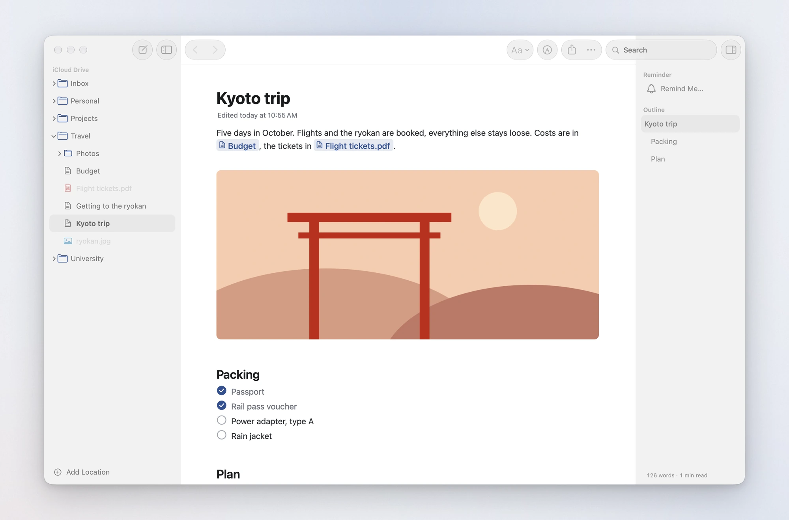
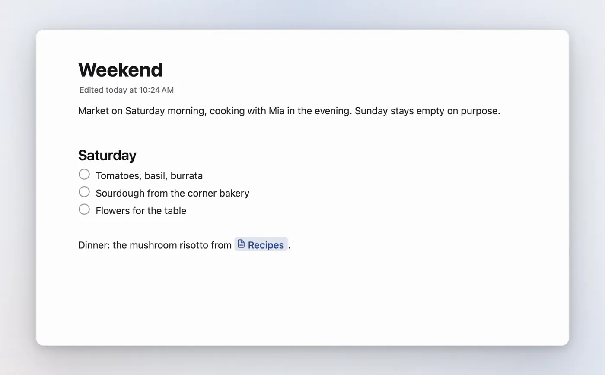
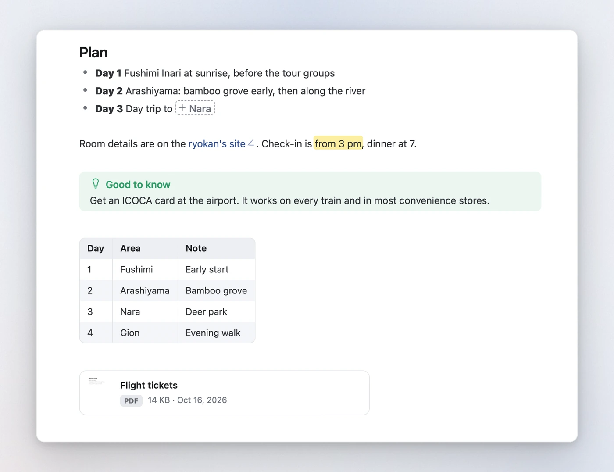
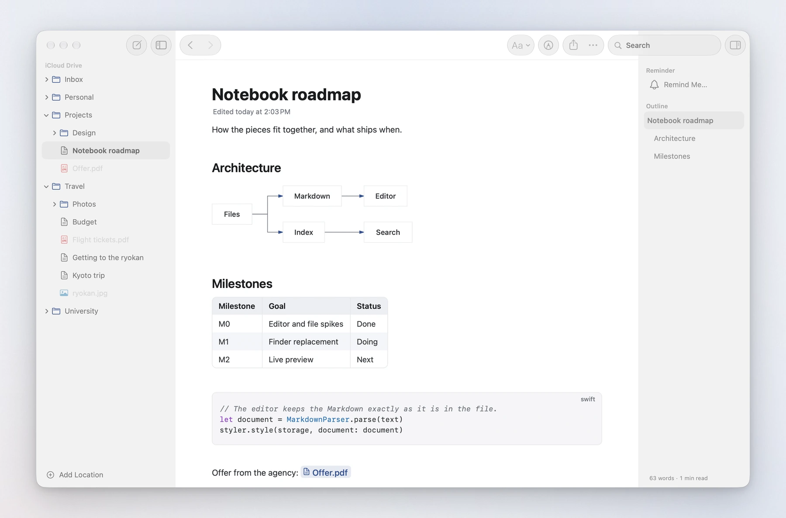
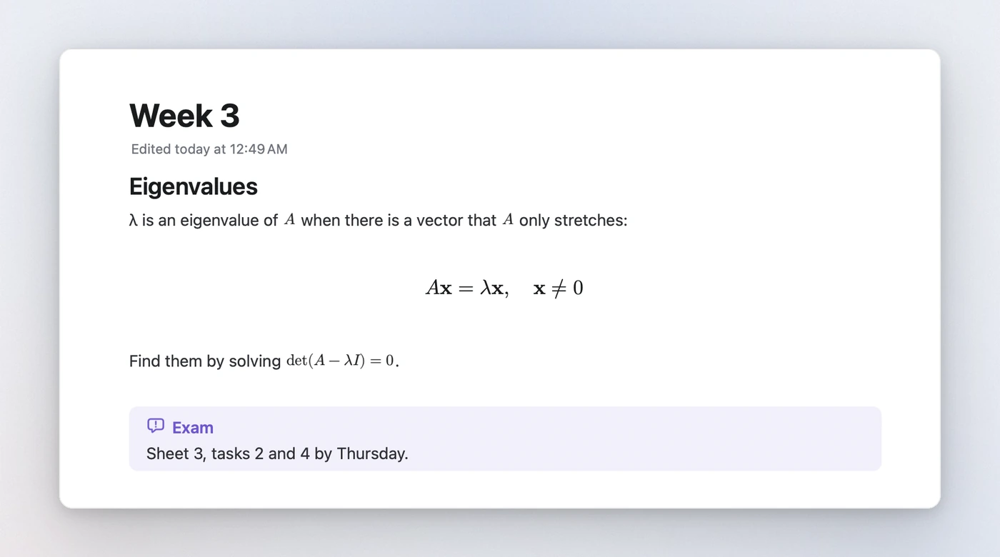
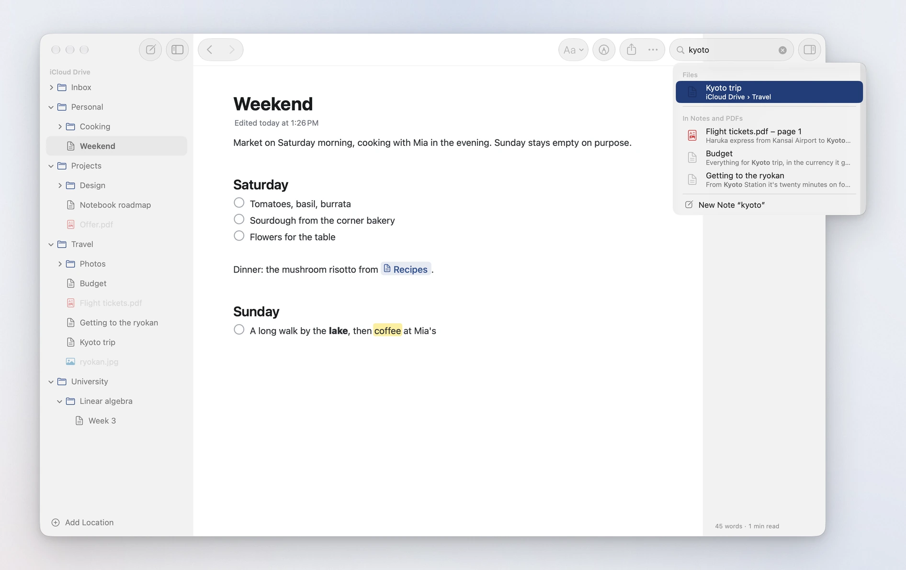
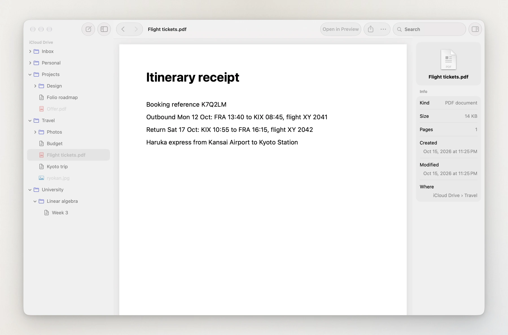

<p align="center">
  
</p>

<h1 align="center">Folio</h1>

<p align="center">
  <b>Markdown notes for the Mac that write like Apple Notes</b>, kept as plain files in your own folders.<br>
  No database, no import and no sync of its own: iCloud Drive, or any folder you choose, is the library.
</p>

<p align="center">
  
  
  
  <a href="LICENSE"></a>
  <a href="CHANGELOG.md"></a>
</p>

<p align="center">
  <a href="#a-quick-tour"><b>Tour</b></a> &nbsp;·&nbsp;
  <a href="#how-notes-are-stored"><b>File format</b></a> &nbsp;·&nbsp;
  <a href="#getting-started"><b>Getting started</b></a> &nbsp;·&nbsp;
  <a href="#using-it"><b>Shortcuts</b></a> &nbsp;·&nbsp;
  <a href="CHANGELOG.md"><b>Changelog</b></a>
</p>

<br>

<picture>
  <source media="(prefers-color-scheme: dark)" srcset="Design/screenshots/hero-dark.webp">
  
</picture>

> **Status: early.** Version 0.1.0 is a Mac app you build from source (five minutes, see below). It already covers
> writing, organising and finding notes day to day. iPhone and iPad versions, quick capture and the App Store come
> later; see [Not there yet](#not-there-yet).

## Why

Apple Notes is a pleasure to write in, but it keeps your notes in its own database. Markdown apps keep them as files,
but most of them feel like a code editor or ask you to move everything into a vault. Folio does both: it shows the
folders you already have, iCloud Drive first, and turns the Markdown files in them into notes that write like Notes.
Pictures, PDFs and every other file sit right next to them and open in the window: PDFs and pictures as in Preview,
videos as in QuickTime Player, the rest in Quick Look. What Folio saves is ordinary Markdown that GitHub, Obsidian or
iA Writer read just the same.

## A quick tour

### Markdown that gets out of the way

You write Markdown, and Folio shows the result as you type. The marks show faintly next to the caret, only for the
bit you're on, and fold away when you move on. Headings hide their `#` once you type the space after them; while the caret is on
one, its level sits in the margin, and a click there turns it into a title, heading, subheading or body text. Lists continue on Return,
Tab nests them, and checkboxes tick with a click.

<picture>
  <source media="(prefers-color-scheme: dark)" srcset="Design/screenshots/typing-dark.webp">
  
</picture>

Nothing moves while you select text or hold the mouse button, so a selection never jumps. Long notes type and scroll
without a stutter.

### Pictures, links and files are objects

Pictures, `[[links]]` to other notes and files you drop in behave as in Notes: the caret steps over them, Backspace
removes one whole, and their Markdown never shows. Type `[[` for suggestions; a link to a note that doesn't exist yet
is drawn dashed and creates the note with a click. Web links show their text with a small pencil that edits the
address. A PDF or any other file on a line of its own becomes a card with a preview, and Space opens it in Quick Look.

<picture>
  <source media="(prefers-color-scheme: dark)" srcset="Design/screenshots/objects-dark.webp">
  
</picture>

Paste or drop a picture and it's saved next to the note, in a hidden `.assets` folder, as PNG or JPEG so that other
apps can show it. Delete it from the note and the file goes to the Trash once you leave the note, unless another note
in the folder still uses it. Move a note to another folder and its pictures move along.

### Tables, diagrams, code and maths

Tables are drawn as tables, Mermaid diagrams as diagrams (natively, without a web view), code with highlighting for
about forty languages, and LaTeX maths as typeset formulas. Click into one and its source appears, with a live
preview for diagrams and formulas. Point at a code block and a button in its corner copies the code. Callouts in
GitHub's and Obsidian's `> [!note]` style get their colour and symbol.

<picture>
  <source media="(prefers-color-scheme: dark)" srcset="Design/screenshots/blocks-dark.webp">
  
</picture>

<picture>
  <source media="(prefers-color-scheme: dark)" srcset="Design/screenshots/math-dark.webp">
  
</picture>

### Find anything with ⌘F

The search field in the toolbar finds notes and files by name, and words inside notes and PDFs, with the page they're
on. Return opens the first match, and the last suggestion is always a new note with what you typed as its name.
With an empty field, it lists what you opened last.

<picture>
  <source media="(prefers-color-scheme: dark)" srcset="Design/screenshots/search-dark.webp">
  
</picture>

### PDFs, pictures and every other file

Folio is a browser for your folders, not only for notes. A PDF opens right in the window the way Preview shows it, its
pages one under the other: there at once, and back where you left it when you return. A picture fits the window on the
same grey, never larger than it is; pinch or double-click to zoom in on a spot. A video plays with the system's
controls, as in QuickTime Player. A spreadsheet or any other file opens in Quick Look. The inspector shows a file's
details, and "Open in" hands it to its own app.

<picture>
  <source media="(prefers-color-scheme: dark)" srcset="Design/screenshots/quicklook-dark.webp">
  
</picture>

### A Mac app, made of the Mac's parts

The window is built from the system's own pieces: a source-list sidebar, a toolbar with the system's search field and
share menu, an inspector, Settings, alerts, PDFKit, AVKit and Quick Look. It follows the system's light or dark
appearance. The inspector shows a note's outline, with the section you're reading marked and a word count; a click on
a heading scrolls there. In Settings › Text you pick the typeface (San Francisco, New York, Rounded or Monospaced),
the size, the line spacing and the line width. The icon is a leather notebook, and Settings › App Icon makes it yours:
pick the leather, the elastic band, the ribbon and the background, and the Dock shows your notebook while Folio is
open. Links, the caret and folders are in ink blue to go with it, or in the accent colour you chose in System Settings.

## What it does

- **Notes are files.** The title is the file name: rename a note by editing its title, and links to it in other notes
  follow. New notes go into the folder you're in.
- **Folders as they are.** Add iCloud Drive or any folder as a location in the sidebar, with ⌘O or File › Add
  Location. iCloud Drive shows what the Finder shows in it: Desktop and Documents when they are kept in iCloud, and the
  folders of apps such as Pages or Obsidian. Create, rename, duplicate and move notes and folders, by drag and drop or
  with Move To; Option-drag copies. Deleting moves to the Trash, never further. Favourites sit at the top of the
  sidebar.
- **Live preview editor.** Headings, bold, italic, strikethrough, `==highlight==`, inline code, links, checklists,
  bulleted and numbered lists, quotes, callouts, tables, code blocks, maths, Mermaid, footnotes and front matter, which
  folds into a small "properties" pill.
- **Pictures and files in notes.** Paste or drop them in; `![[embeds]]` of other notes show an excerpt, of files a
  card with a preview.
- **PDFs, pictures, videos and other files** open in the window: PDFs and pictures as in Preview, videos as in
  QuickTime Player, the rest in Quick Look.
- **Search** across file names, note text and PDF text.
- **Saves as you type,** and never overwrites a change made somewhere else (see below).
- **Export** a note as a PDF or a PNG image, or print it.
- **Single files.** Open any Markdown file from the Finder or with ⌘O, and it gets a plain window of its own.

## How notes are stored

Everything is plain Markdown, so other apps keep reading your notes. Folio adds no files of its own besides the
`.assets` folders for pictures and files you add to notes.

| What | In the file | In Folio |
| --- | --- | --- |
| Title | The file name, `Weekend.md` | A large title above the text; editing it renames the file |
| Picture | `` | The picture, fitted to the width |
| Link to a note or file | `[[Recipes]]`, `[[Recipes\|text]]`, `[[Offer.pdf]]` | A link you click; dashed when the target doesn't exist yet |
| Embed | `![[Recipes]]`, `![[Offer.pdf]]` | An excerpt of the note, or a card for the file |
| Web link | `[text](https://…)` | The text, with a pencil to edit the address |
| Checklist | `- [ ]`, `- [x]` | A checkbox; done items turn grey |
| Highlight | `==text==` | A yellow highlight |
| Callout | `> [!tip] Title` | A coloured box with a symbol |
| Maths | `$x^2$`, `$$ … $$` | A typeset formula |
| Diagram | ```` ```mermaid ```` | The diagram |
| Front matter | `---` YAML `---` at the start | A small pill; click to see the YAML |

`[[Name]]` finds the note by its name, ignoring case and accents: one in the same folder first, then the one with the
shortest path. `[[Folder/Name]]` says exactly which. Remote pictures (``) are not downloaded; Folio
shows their address instead.

## When a note changes somewhere else

Notes are often open on more than one Mac, or in more than one app. Folio watches the open note and the folders in the
sidebar. If a note changes elsewhere while you haven't typed, it reloads quietly, and your caret and scroll position
stay where they were. If both sides changed, Folio merges the two line by line, before every save as well, so it never
writes over a change it hasn't seen. Only when both changed the same lines does it ask: keep this version, use the
other one, or keep both as two files. Conflicts that iCloud Drive reports are handled the same way.

Notes in iCloud Drive that aren't downloaded yet are fetched so that search finds them; other files that live only in
iCloud show a cloud in the sidebar and download when you open them.

## Getting started

### Requirements

- A Mac with Apple silicon and macOS 27 or later
- Xcode 27 or later, to build it

### Build and run

```bash
git clone https://github.com/lukaskaibel/folio.git
```

```bash
open folio/Folio.xcodeproj
```

Choose the **Folio** scheme and press ⌘R. A local build needs no Apple developer account: without a team, Xcode signs
it to run on your Mac. To sign with your own team, create `Config/Local.xcconfig` with `DEVELOPMENT_TEAM = <your
team ID>`; it isn't checked in.

### Adding your notes

On first launch, Folio asks for a folder: **Open iCloud Drive**, or **Choose another folder…**. Add more later with
File › Open… (⌘O), File › Add Location…, Settings › General, or by dropping a folder on Folio in the Dock. Folio works
on the files in place; nothing is copied or imported.

To look around without your own notes, run a Debug build with the arguments `-FolioLibrary /tmp/FolioSample
-FolioDemo YES` (Product › Scheme › Edit Scheme › Arguments). It writes a few sample notes, pictures and PDFs to that
folder and shows only them, for that run.

## Using it

| Shortcut | Action |
| --- | --- |
| ⌘N | New note in the current folder |
| ⇧⌘N | New folder |
| ⌘F | Search |
| ⌘[ and ⌘], or swipe between pages | Back and forward; the swipe follows System Settings, as in Safari |
| ⌘O | Open a Markdown file in a window of its own, or a folder in the sidebar |
| ⌃⌘S | Show or hide the sidebar |
| ⌃⌘I | Show or hide the outline |
| ⌘+, ⌘− and ⌘0 | Bigger, smaller and actual text size |
| ⌥⌘E | Export as PDF |
| ⌘P | Print |
| ⌘, | Settings |

While writing:

| Shortcut | Action |
| --- | --- |
| ⌘B, ⌘I | Bold, italic |
| ⇧⌘X | Strikethrough |
| ⌃⌘H | Highlight |
| ⌘E | Inline code |
| ⌘L | Link: wraps the selection, or starts a `[[link]]` |
| ⇧⌘T, ⇧⌘H, ⇧⌘J, ⇧⌘B | Title, heading, subheading, body |
| ⇧⌘L | Checklist |
| ⇧⌘U | Mark as checked |
| ⇧⌘7, ⇧⌘9 | Bulleted list, numbered list |
| ⌘' | Block quote |
| Tab, ⇧Tab | Nest or un-nest a list item (in code: indent) |
| ⌥⌘] and ⌥⌘[ | Increase and decrease indent |
| `*`, `_`, `` ` ``, `~` or `=` with text selected | Wrap the selection in that mark |
| `[[` | Suggestions for a link; ↑↓ and Return or Tab to pick |
| Space on a selected picture | Quick Look |
| ↑ on the first line | Into the title; Return, Tab or ↓ back into the text |

In the sidebar: Return renames, ⌘⌫ moves to the Trash, and Space opens a file in Quick Look. Right-click a file or
folder for everything else, including Copy Link, which copies a `[[link]]` to it.

## Not there yet

Folio is a Mac app today. Planned, and not built yet:

- **iPhone and iPad**, from the same project, with a writing bar above the keyboard, the camera and the document
  scanner.
- **Quick capture:** a widget, a control in Control Center and on the Lock Screen, the Action button and a share
  extension, all adding a note to an Inbox folder.
- **Spotlight,** text recognition in pictures and scans, and a search index that's kept between launches; today it is
  rebuilt at every launch.
- Links follow a renamed note, but not yet a moved one, a renamed folder or a rename in a single-file window.
  Footnotes are styled but don't jump to their text.
- Translations: the app is in English only.

The full plan, with what is deliberately left out (tags, backlinks, a database, sync of its own), is in
[PLAN.md](PLAN.md), in German.

## For contributors

```
Folio/                       The app target: the entry point and the icon
Packages/FolioKit/
  Sources/FolioKit/
    Editor/                  The live-preview editor on TextKit 1: styling, hidden marks, objects, typing, export
    Markdown/                Folio's Markdown parser, which keeps every character's position in the file
    Render/                  Tables, maths, diagrams and code highlighting
    Files/                   Locations, the file tree, file operations, saving, watching and the three-way merge
    Index/                   Search over names, note text and PDF text, and how [[links]] resolve
    UI/                      The window, sidebar, inspector, search field, Settings, file windows, PDFs, pictures,
                             videos and Quick Look
    Debug/                   The debug remote and the sample notes (Debug builds only)
  Tests/                     Parser, editor, merge, smoothness and app icon tests
Config/                      Build settings, Info.plist and entitlements
Design/                      The icon, the README pictures and the social preview
Tools/                       The app icon and the README pictures
PLAN.md                      The plan: decisions, file format, architecture and milestones (in German)
```

The editor is the heart of the app. The text view holds the file's Markdown exactly, character for character, and
everything you see is styling on top: marks are hidden as zero-width glyphs and objects are drawn in place of a
character, so undo, dictation and spell checking behave as everywhere else on the Mac. Start reading at
`Editor/EditorController.swift` and `Editor/FolioLayoutManager.swift`.

Run the tests (they use off-screen windows and temporary folders, and touch none of your files):

```bash
cd Packages/FolioKit && swift test
```

The pictures in this README are made by a script. It builds the app, runs it in the background on the sample notes,
takes the scenes in light and dark, and lays them out together with `Design/social-preview.png`. It doesn't take over
your Mac (only the search suggestions show on screen for a moment) and leaves your own Folio's settings alone. Run it
again when a change shows in one of them:

```bash
Tools/readme-images.sh
```

The app icon is drawn by `Tools/AppIcon/notebook.py`. After changing it, run the script below: it writes
`Folio/AppIcon.icon` and renders, with Icon Composer's `ictool`, the grey passes that Settings › App Icon colours in
any leather (it needs Python 3 with NumPy and Pillow, and `brew install librsvg`):

```bash
Tools/AppIcon/make.sh
```

Debug builds can be driven from a file: launch with `-debugCommandFile <path>` and append commands such as
`open Travel/Kyoto trip.md`, `type Hello`, `key return` or `snapshot <file>` to it, one per line. The commands are
listed in `Debug/DebugRemote.swift`.

See [CONTRIBUTING.md](CONTRIBUTING.md) for how to propose changes.

## Versions

The project follows [semantic versioning](https://semver.org). Every release is tagged (`v0.1.0`) and described in
the [changelog](CHANGELOG.md). Until 1.0, minor versions may change behaviour.

## Acknowledgements

Built with [BeautifulMermaid](https://github.com/lukilabs/beautiful-mermaid-swift), which lays diagrams out with
[elk-swift](https://github.com/lukilabs/elk-swift) (Eclipse Public License 2.0; its source is at that link), and
[SwiftMath](https://github.com/mgriebling/SwiftMath). The way notes write is inspired by Apple Notes.

Folio is an independent project and is not affiliated with, endorsed by, or sponsored by Apple.

## License

[MIT](LICENSE) © Lukas Kaibel
